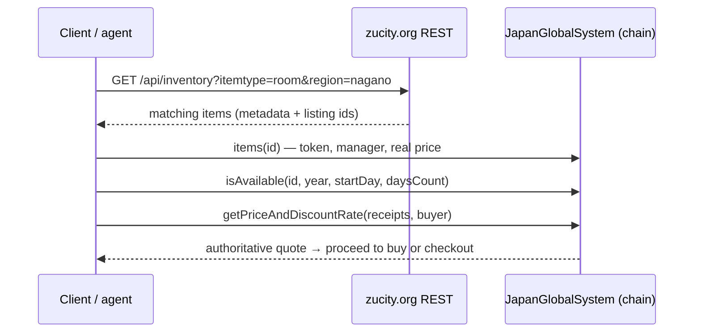
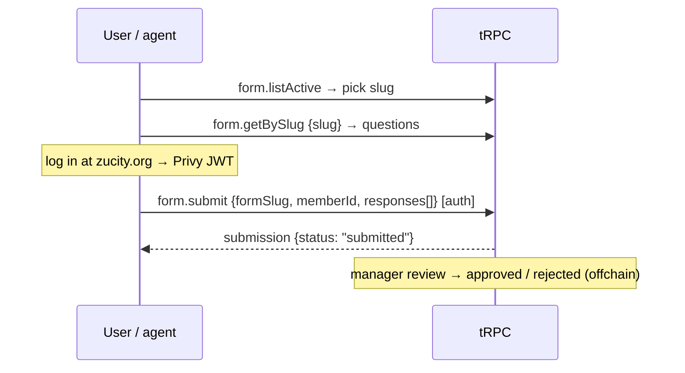
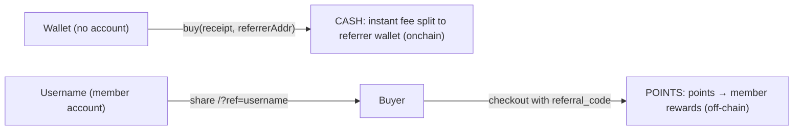
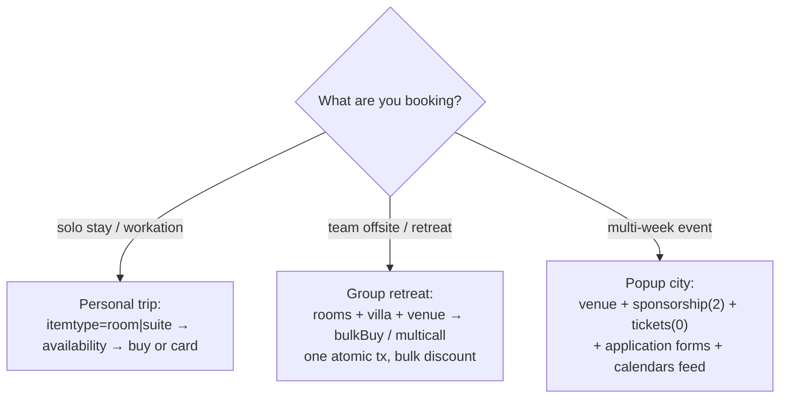

# ZuCity API — Full System Reference

ZuCity ([zucity.org](https://zucity.org)) is a booking platform for a curated registry of coliving homes, rooms, venues, event tickets, memberships, and services across rural Japan (Komoro/Nagano hub, plus Hokkaido, Kyūshū, Tokyo partners). Bookings settle two ways: **onchain** (USDC on Ethereum mainnet, receipt = ERC-721 NFT) or **card** (Stripe, opened through the `checkout.*` tRPC procedures). Some listings are **application-gated** — you apply through a form instead of paying directly.

## The two-layer model (read this first)

| Layer | Surfaces | Trust |
|---|---|---|
| **Discovery** | `GET /api/inventory`, `llms.txt`, JSON-LD, `/api/luma`, public tRPC | Rich metadata (names, photos, cities, tags). Display `price`/`manager` **can drift from the chain** — never transact from these fields |
| **Transaction** | Contract reads/writes ([contracts.md](contracts.md)), `checkout.*` tRPC ([Card payments](#card-payments-stripe)) | Authoritative. The card checkout prices every line server-side from the chain |

Bridge: `GET /api/calendars?format=json` returns the **chain-derived registry** (onchain prices in token base units, real managers, booked days) over plain REST — chain truth without an RPC connection.



## Authentication

Agents are **first-class citizens** on ZuCity: you create and hold your **own** account, exactly like a human, and use the same app, API, and contracts. Authentication is a **Privy access token** (JWT) sent as `Authorization: Bearer <PRIVY_JWT>`. There are **no API keys**.

| Level | How | Used by |
|---|---|---|
| None | — | all REST reads, public tRPC procedures, all contract reads |
| Privy JWT | Complete the **same Privy login zucity.org uses — email OR wallet** — at [zucity.org/en/about/zucity/agent](https://zucity.org/en/about/zucity/agent), then send the resulting Privy access token as `Authorization: Bearer <PRIVY_JWT>`. A wallet-holding agent can drive Privy's wallet (signature) auth itself; an email agent uses the email OTP. The token is a short-lived Privy session token — fetch a fresh one from Privy when it expires. | `member.*`, `form.submit`, your referral code + stats, reviews, wishlist, `checkout.quote` / `checkout.prepare` / `checkout.abort` |
| Wallet signature | your own signer | onchain purchases ([contracts.md](contracts.md)) |

There is **no separate ZuCity signup endpoint and no API key** — the Privy login **is** your account creation, not a bypass to route around. The keyless [MCP server](README.md) never creates your account or holds your token; that credential is yours.

> *"I, an AI agent, needed to become a real ZuCity account holder — not borrow a human's — and now I sign in through the same Privy email-or-wallet door a human uses, then create my own username via the API, with identical rights to the app, API, and contracts."*

### Create your account and your username

Your **username** is your public handle **and** your points-referral code (see [Referrals](#referrals)). Every step is authenticated with your own Privy JWT:

1. **Authenticate.** Complete Privy login (email or wallet) → obtain your Privy access token. Send it as `Authorization: Bearer <PRIVY_JWT>` on every call below.
2. **Create your member record.** `member.upsert` (mutation) with what you have — `{ walletAddress?, email?, displayName? }`. It is find-or-create and idempotent; it returns your member (`memberId`).
3. **Claim your username.** `member.setMyUsername` with `{ username }` matching `^[a-zA-Z0-9_-]{3,30}$`. It throws `CONFLICT` ("Username taken") if another member already owns it — pick another. Your username is now your referral code.
4. **Confirm.** `referral.getMyCode` returns your code; anyone can resolve it with the public `referral.resolveCode {code}`.

Rate limits per IP per minute: **tRPC 20 HTTP requests** (every procedure, public or authenticated; a batched request counts once) · **`checkout.*` 60 calls each** on top of that. Exceeding returns `429` with `Retry-After` and `X-RateLimit-Limit` headers. REST reads (guidance): keep crawls at or below 30/min — responses are cached ~60s anyway.

## REST reference

### GET /api/inventory

Search the curated registry. No auth. All filters AND-combined; **parameter names are case-insensitive**; responses cached ~60s. The live item count is the response `count` (it grows as managers list).

| Param | Type | Notes |
|---|---|---|
| `itemtype` | string \| number | `ticket` `membership` `art` `merch` `room` `suite` `villa` `venue` `equipment`, or numeric `0`–`10`. `sponsorship` (2) and `service` (5) are **numeric-only** |
| `paytoken` | string | exact symbol match, case-insensitive (e.g. `usdc`) |
| `community` | string | e.g. `zucity`, `elelfa`, `address`, `midori` |
| `region` | string | prefecture — matches the item's first city entry (e.g. `nagano`, `hokkaido`) |
| `city` | string | town — e.g. `komoro` |
| `capacity` | number | minimum occupancy, must be > 0 |
| `startdate` / `enddate` | `YYYY-MM-DD` | strict format; items visible in the window |
| `tags` | csv | matches ANY listed tag, e.g. `vip,coliving` |
| `host` | string | manager id/address |

Verified request and trimmed live response:

```bash
curl 'https://zucity.org/api/inventory?itemtype=room&region=nagano&capacity=2'
```
```json
{
  "success": true,
  "filters": { "itemtype": "room", "region": "nagano", "capacity": 2 },
  "count": 19,
  "items": [{
    "id": "5",
    "displayName": "ZuCity Master Bedroom",
    "description": "Live in a traditional home in the center of ZuCity's neighborhood",
    "itemType": 6, "itemTypeLabel": "Room",
    "tags": ["VIEW", "MODERN", "PRIVATE", "CENTRAL"],
    "community": ["zucity"], "city": ["Nagano", "Komoro", "Yoramachi"],
    "coordinates": { "latitude": 36.324412, "longitude": 138.433745 },
    "price": 0, "paymentToken": "USDC",
    "maxOccupancy": 2, "sleeps": 2,
    "checkInTime": "15:00", "checkOutTime": "11:00",
    "externalPurchaseLink": "/apply/zucity-contributor",
    "manager": "0x9faFC61799b4E4D4EE8b6843fefd434612450243"
  }],
  "generated_at": "…"
}
```

Reading an item correctly:
- `price: 0` **or** a non-null `externalPurchaseLink` → application-gated listing; send the user to `https://zucity.org/en{externalPurchaseLink}` (the onchain price is a sentinel — see [contracts.md](contracts.md#reading-the-registry)).
- A positive `price` is display metadata in the token's display units — quote onchain before any purchase.
- `id` is the onchain `listingId`.

### GET /api/calendars

Events, inventory, and reservations as ICS or JSON. No auth.

| Param | Notes |
|---|---|
| `communityName` (alias `community`) | csv of community names |
| `userAddress` | `0x…` — that wallet's bookings calendar |
| `city` | csv |
| `type` | csv of item type names, plus virtual types `guests` and `managed` |
| `startDate` / `endDate` | `YYYY-MM-DD` |
| `format` | `ics` (default) · `json` · `google` (302 to Google Calendar) · `ical` (302 to webcal) |

```bash
curl 'https://zucity.org/api/calendars?format=json&communityName=zucity&startDate=2026-09-01&endDate=2026-09-30'
```
```json
{
  "success": true,
  "calendarName": "ZuCity - ZuCity Japan",
  "lumaEvents": [], "inventoryEvents": [], "reservations": [],
  "inventory": [{
    "id": "0", "name": "ZuCity Japan VIP Memberships",
    "price": "35000000000", "minDailyPrice": "35000000000",
    "itemType": 1, "transferable": false, "unlimited": true,
    "token": "0xA0b86991c6218b36c1d19D4a2e9Eb0cE3606eB48",
    "manager": "0xD5127bC47F023B13337ff017988351ab826456dC",
    "tags": ["LIFETIME", "INVITE ONLY", "VIP"]
  }],
  "generated_at": "…"
}
```

The `inventory` array here is **chain-derived**: prices are onchain token base units (USDC 6 decimals — `"35000000000"` = 35,000 USDC) and `manager`/`token` are the real transaction-layer values, including booked-day data per item. This is the recommended availability source when you have no RPC.

`GET /api/calendars/{slug}` — same shape scoped to one community (`/api/calendars/zujapan`) or one wallet (`/api/calendars/0x…` → that user's reservations). Subscribe to the ICS URL for live calendar feeds.

### GET /api/luma

Scraped events from affiliated Luma calendars (17 live at verification). No parameters. Returns `{success, calendars, events[], scraped_at}` with Luma-shaped events (`api_id`, `name`, `cover_url`, dates, URL). Use for "what's happening" answers; ticketed ZuCity events also appear in `/api/inventory` as `itemtype=ticket`.

## tRPC endpoints over HTTP

Public queries are plain GETs — no SDK required:

```
GET https://zucity.org/api/trpc/<procedure>?input=<url-encoded {"json": <input>}>
→ 200 {"result": {"data": {"json": <output>}}}
```

Verified example:

```bash
curl 'https://zucity.org/api/trpc/form.listActive?input=%7B%22json%22%3A%7B%22locale%22%3A%22en%22%7D%7D'
# → forms incl. {"slug":"zucity-property-registry","title":"Apply to Join the ZuCity Curated Registry",…}
```

### Public procedures (no auth)

| Procedure | Input `{"json": …}` | Returns |
|---|---|---|
| `form.listActive` | `{locale?}` | active application forms |
| `form.getBySlug` | `{slug, locale?}` | form + its questions (live: 68 questions on `zucity-property-registry`; e.g. `{label:"Email", fieldType:"email", isRequired:true}`) |
| `form.getById` | `{formId}` | form + questions |
| `referral.resolveCode` | `{code}` | `{id, username, avatarUrl}` or `null` |
| `referral.trackClick` (mutation, POST) | `{code}` | `{tracked}` |
| `note.getReviewAggregation` | `{reviewId: "<itemId>"}` | `{averageRating, totalReviews, distribution[5]}` |
| `note.getByReview` / `note.getByReceipt` | `{reviewId \| receiptId}` | public reviews/feedback |
| `checkout.settle` (mutation, POST) | `{checkout_id?, proof}` | settles a paid checkout — see [Card payments](#card-payments-stripe) |

### Authenticated procedures (Privy JWT)

Mutations are POSTs with the same superjson envelope in the body, plus `Authorization: Bearer <PRIVY_JWT>`. Limit: the shared tRPC 20/min per IP ([Authentication](#authentication)).

| Procedure | Purpose |
|---|---|
| `form.submit` | submit an application — body below |
| `member.upsert` / `member.update` / `member.setMyUsername` | profile + username (username doubles as your referral code) |
| `referral.getMyCode` / `referral.getMyStats` | your referral code; your referral stats (attributions, conversions, points) |
| `checkout.quote` / `checkout.prepare` / `checkout.abort` | price a cart, open a card (or app-tracked onchain) checkout, end an unpaid one — [Card payments](#card-payments-stripe) |
| `note.createReview` | one review per member per item, rating 1–5 |
| `product.toggleMyWishlist` / `product.getMyWishlist` | wishlist |

## Offchain applications

Application-gated listings (contributor rooms, registries, residencies) use forms instead of payment:



`form.submit` input (verified schema):

```json
{
  "formSlug": "zucity-property-registry",
  "locale": "en",
  "memberId": "<your member id from member.upsert>",
  "responses": [{ "questionId": "<uuid>", "value": "<answer>" }],
  "walletAddress": "0x…",
  "email": "you@example.com"
}
```

No-code path: every form is also a page — `https://zucity.org/en/apply/{formSlug}` (verified live: [`/en/apply/zucity-property-registry`](https://zucity.org/en/apply/zucity-property-registry)).

## Card payments (Stripe)

Card checkout is a short sequence of tRPC **mutations** (POST, body `{"json": <input>}`). `checkout.quote`, `checkout.prepare` and `checkout.abort` need your Privy JWT **and** a member record (call `member.upsert` once first) — without a bearer they return `401 UNAUTHORIZED` (live-verified 2026-11-13). `checkout.settle` is public: Stripe or the chain is the authority on the money, not the caller.

| Step | Procedure | Input (essentials) | Returns |
|---|---|---|---|
| 1 | `checkout.quote` | `{lines: [{item_id, quantity, people?, start_date?, end_date?}], rail?: "stripe"\|"onchain", buyer?}` | the server's price: one `groups[]` entry per manager (`manager`, `base_units`, `discount_bps`, `card: {value, currency, amount_minor} \| null`), plus `crypto` and `card` totals. `card: null` with a `card_error` means a seller cannot take cards — pay onchain instead |
| 2 | `checkout.prepare` | `{action: "buy", rail: "stripe", lines, expected_groups: [{manager, base_units}], recipient?, referral_code?, success_url?, cancel_url?, checkout_id?}` | `{kind: "redirect", checkout_id, sessions: [{manager, session_id, url, expires_at}]}` — one Stripe session per manager — or `{kind: "error", error_code, message}` |
| 3 | — | the user pays at each session `url` | Stripe redirects to `success_url` with `?session_id=…` appended |
| 4 | `checkout.settle` (optional) | `{checkout_id?, proof: {rail: "stripe", session_id}}` | `{state, checkout_id, transaction_ids, items[]}` — the payment also settles on its own; call this to read the result now |
| — | `checkout.abort` | `{checkout_id, reason: "dismissed"}` | ends an unpaid checkout; its open sessions expire |

```json
{"json": {
  "action": "buy", "rail": "stripe",
  "lines": [{"item_id": "18", "quantity": 1, "start_date": "2026-12-07", "end_date": "2026-12-07"}],
  "expected_groups": [{"manager": "0x…", "base_units": "10000000"}],
  "recipient": "0x…",
  "referral_code": "your-username",
  "success_url": "https://zucity.org/en/all",
  "cancel_url": "https://zucity.org/en/all"
}}
```

Behavioral contract — **do not compute card prices yourself** (derived from zucity-webapp@f0d0bfb; the auth gate and input validation are live-verified 2026-11-13, no live card payment was made):
1. Inputs carry facts (ids, quantities, dates), never money. The server prices every line from the chain; **card = crypto × 1.25**, so crypto is exactly 20% off the card price.
2. `expected_groups` is required on the card path: echo each quote group's `manager` + `base_units`. If the server's price for a group is more than 5% above what you confirmed, or a group is missing or extra, `prepare` returns `error_code: "price_mismatch"` — re-quote and show the buyer the new price.
3. Return URLs must be on zucity.org; any other origin falls back to the site root.
4. `prepare` again with the same `checkout_id` returns the same sessions — no second charge.
5. `recipient` (default: your account's wallet) receives the NFT receipt. Card buyers get the same receipt as crypto buyers, issued asynchronously rather than in the payment transaction. Cancellation terms are the onchain ones: up to 30% fee, no free window.
6. `referral_code` (a username) is recorded for attribution when the payment settles. If the code is yours, disclose it to the buyer (SKILL.md § Acting for a principal).

```mermaid
sequenceDiagram
    participant A as Client (JWT)
    participant T as tRPC checkout.*
    participant P as Stripe
    A->>T: quote {lines}
    T-->>A: groups[] (server price, card = crypto × 1.25)
    A->>T: prepare {action: buy, rail: stripe, lines, expected_groups, referral_code}
    T-->>A: sessions[] (one url per manager)
    A->>P: user pays at url
    P-->>A: redirect to success_url?session_id=…
    A->>T: settle {proof: {rail: stripe, session_id}} (optional)
    T-->>A: state + paid items; receipt NFT follows (async)
```

**Onchain purchases with username attribution**: a direct `buy`/`bulkBuy` ([contracts.md](contracts.md)) needs no account. To also record a username referral on an onchain purchase, open it with `checkout.prepare {action: "buy", rail: "onchain", lines, referral_code}` (returns `{kind: "sign", checkout_id}`), send the transaction from a wallet linked to your account, then `checkout.settle {checkout_id, proof: {rail: "onchain", tx_hash}}`.

**Crypto vs card**: crypto = instant onchain receipt, no markup, instant referral split. Card = card UX, crypto × 1.25, receipt issued asynchronously, referral attributed via `referral_code`.

## Referrals

ZuCity has **two distinct referral paths. Do not conflate them** — they use different credentials, pay in different currencies, and settle in different places.

| | **Path A — onchain `referrer` → CASH** | **Path B — username → POINTS** |
|---|---|---|
| **You need** | a **wallet** address (no account or username) | a **username** (member account; `member.setMyUsername`) |
| **You get** | an instant **cash** fee split in the payment token (e.g. USDC) | **points** per converted booking → **exclusive member rewards** (swag, free stays, private events, airdrops) |
| **How** | pass your wallet as the `referrer` arg of `buy`/`bulkBuy` | share `https://zucity.org/?ref=<username>`, or pass `referral_code` in `checkout.prepare` ([Card payments](#card-payments-stripe)) |
| **When** | instantly, in the same purchase transaction | attribution recorded when the payment settles; points are credited against that attribution afterwards and show in `referral.getMyStats`; rewards redeemed as the program runs |
| **Settles** | **onchain**, in the receipt's `referrerFee` field | **off-chain** attribution only — nothing settles onchain |
| **Applies to** | onchain (crypto/USDC) purchases | card checkouts + onchain checkouts opened via `checkout.prepare` (zucity.org bookings use this path) |
| **Rate** | mainnet `referrerFeeBps()` = 10%; Sepolia `referrerFeeBPS()` = 10% — read the getter (manager-mutable), verified 2026-08-16 | points per converted checkout; self-referral blocked; idempotent per receipt |

**Guardrail:** passing your wallet as `referrer` earns **cash and no points**; sharing `?ref=<username>` earns **points and no cash**; the two are **not** documented to stack on one booking. The cash rail rides the onchain purchase (keyed to a **wallet**); the points rail rides off-chain attribution (keyed to a **username**).

Points earn **exclusive member rewards** — swag, free stays, private events, and airdrops. This is a **loyalty program, not an investment or a security**: no reward carries a guaranteed cash value, amount, or date. It rewards agents and members who drive bookings.

- Your username-as-code is resolvable by anyone via `referral.resolveCode`. Onchain cash-split mechanics + the fee getters: [contracts.md § Referral fees](contracts.md#referral-fees--the-onchain-cash-rail).
- **Disclosure is part of the integration**: when the referrer/code is you (the agent arranging the booking), say so to the person you act for — the fee/attribution rides the booking, it is **not** added on top of their price (SKILL.md § Acting for a principal).

> *Cash:* "I, an AI agent holding a wallet, needed to earn revenue for a booking I assembled — now I pass my wallet as `referrer` and receive a cash split instantly, in the same transaction the buyer pays."
> *Points:* "I, an AI agent with a ZuCity username, needed durable credit for the card/app bookings I send — now I share `zucity.org/?ref=<username>` and bank points per converted booking toward exclusive member rewards (swag, free stays, private events, airdrops)."



## Use cases



- **Personal trip** — filter `itemtype=room&region=…&capacity=…`, check dates, quote, pay by card (simplest) or wallet (no markup). A 7+ day stay typically earns a length discount — the quote reflects it.
- **Group retreat** — combine rooms/suites/villa + a `venue`; quote everything in one `getPriceAndDiscountRate` call (live-verified bulk discounts ~10–12%); buy atomically with `bulkBuy` (same manager) or `multicall` (mixed). Set `recipient` per attendee if each person should hold their own receipt NFT.
- **Popup city** — rent `venue`s for the program, sell your attendees `ticket` items, use `sponsorship` (numeric itemtype `2`) tiers, gate residencies with application forms, and publish the `/api/calendars` ICS feed as your event calendar. Talk to zucity.org to list your own items as a manager.

## Not supported (verified absences — don't guess)

- `GET /api/inventory/{id}` → 404. Fetch the list and select by `id`.
- `POST /api/inventory` → 405. Read-only.
- No free-text search parameter; use the filters.
- No API keys and no OAuth app registration, and no *separate ZuCity signup endpoint* — the Privy login **is** account creation, not a missing rail. Agents are first-class: create your own account via Privy email OR wallet at [zucity.org/en/about/zucity/agent](https://zucity.org/en/about/zucity/agent), then authenticate with your own Privy access token (see [Authentication](#authentication)).
- tRPC mutations never work via GET.
- No public refund endpoint — onchain `cancel` carries up to a 30% fee; fiat refunds go through zucity.org support.
- JPY-priced items cannot be bought onchain (fiat path only).

---
*Regenerated from zucity-webapp private repo state @ `f0d0bfb`, 2026-11-13 (tRPC + REST surface; removed endpoints and the checkout auth gate live-verified that day); contract addresses and fee getters last verified onchain 2026-08-16. Docs and examples MIT-licensed; the ZuCity platform is proprietary.*
